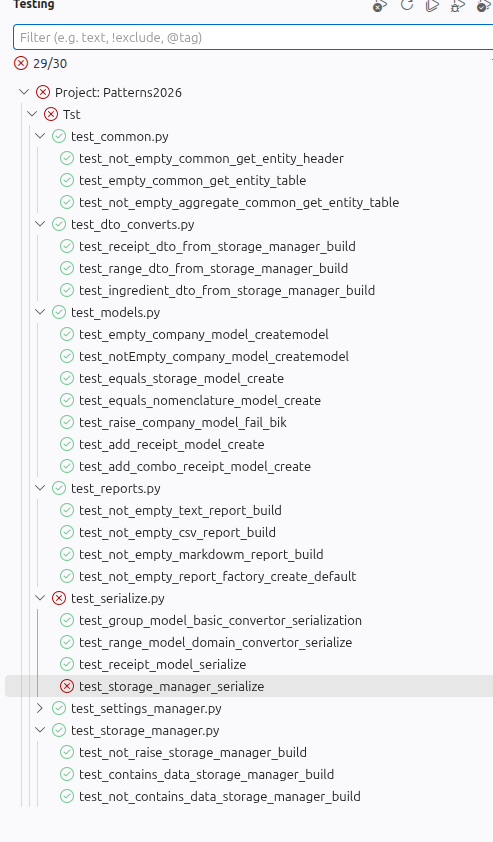

# Письмо

Привет, бро! 
У нас снова проблемы которые мы не можем решить без тебя. Команда в проекте решила реализовать [`чистую архитектуру`](https://habr.com/ru/companies/mobileup/articles/335382/).
Создали отдельно набор `Domain` сущностей и отдельно `Dto`.

Далее, реализовали конвертацию данных и сериализацию в классе [convert](./../Src/Logics/convertor.py)
Однако, у нас никак не получается выгрузить весь набор данных. Постоанно идут ошибки, а причину мы **понять не можем**.

1. Я попросил коллег сделать тесты для проверки выгрузки из [storage_manager](./../Tst/test_serialize.py) 
(возможно не все тесты корректны)

Сейчас следующая картина:
 
 

2. Так же, прошу тебя проверить основной класс Api. 
Список доменных сущностей должен формироваться в `Json`, а так же все отчеты должны поддерживать данный формат.
